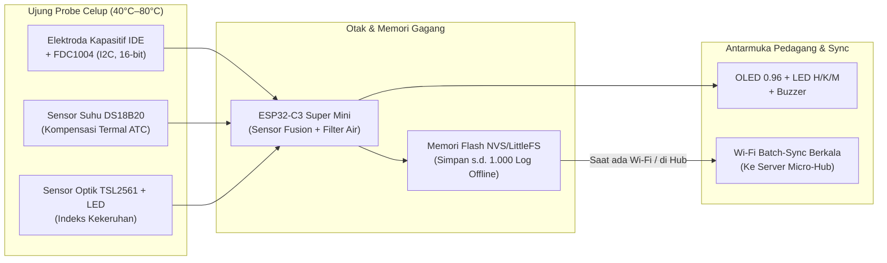
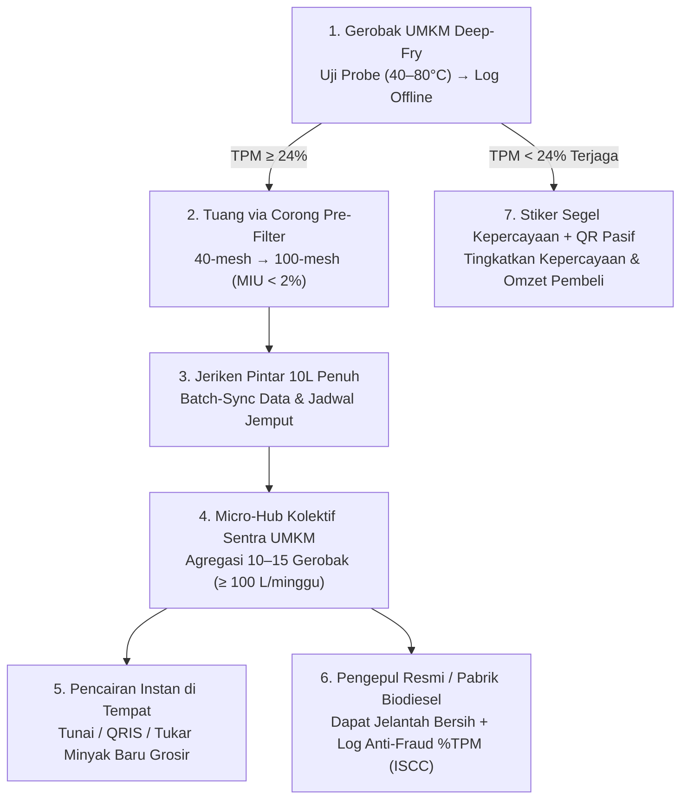

# Bedah Konsep & Perancangan Teknis: Ekosistem Sirkular & *Cyber-Physical* Minyak Jelantah UMKM Gorengan

**Status Dokumen:** Cetak Biru Teknis & Bahan Presentasi Tim (S1 Rekayasa Perangkat Lunak, Telkom University Surabaya)  
**Skema Sasaran:** **PKM-KI 2027** *(alternatif: PKM-K / PKM-PI / P2MW)* — **Tema 8 (Pelestarian Lingkungan)** atau **Tema 9 (Penguatan UMKM)**  
**Visualisasi & Simulator Presentasi:** Buka [preview-ekosistem-jelantah.html](file:///d:/Project/PKM-2027/02-ideasi/preview-ekosistem-jelantah.html) di browser untuk melihat cetak biru interaktif alat, simulator live pembacaan Probe TPM, ilustrasi *Pre-Filter*, dan kalkulator ekonomi *Equipment Lending*.

---

## 1. Penyempurnaan Kritis Konsep (4 Koreksi Teknis & Realitas Wajib)

Konsep 3-in-1 *closed-loop* yang telah dimatangkan (*Probe TPM Hibrida + Corong Pre-Filter & Micro-Hub + Visual Trust Badge & Equipment Lending*) memiliki fondasi sangat kuat untuk skala 1:1 PKM-KI. Agar tahan uji terhadap reviewer teknis maupun lapangan, terdapat **4 koreksi penting** yang sudah diintegrasikan ke dalam rancangan ini:

1. **Rentang Suhu Pengukuran Dinaikkan dari `25°C–70°C` menjadi `40°C–80°C`:**
   - Secara fisika, minyak sawit (*refined palm olein*) yang dipakai menggoreng berulang kali mulai mengental, berkabut (*clouding*), dan membentuk fraksi stearin semi-padat pada suhu **`25°C–35°C`**. Sensor kapasitif komersial (`Testo 270`) juga membatasi suhu operasional minimum di **`40°C`** (di bawah `40°C` muncul error `LO`).
   - **Keputusan Desain:** Pengukuran dilakukan saat minyak hangat **`40°C–80°C`** (15–30 menit setelah kompor mati atau saat pemanasan awal sebelum jualan). Rentang ini tetap aman dari suhu didih `180°C` (menjaga keawetan PCB/PTFE & keselamatan pedagang) sekaligus akurat secara dielektrik.
2. **Proteksi Anomali Air & *Fresh Palm Oil Zeroing*:**
   - Konstanta dielektrik air ($\varepsilon_r \approx 80$) jauh lebih tinggi dibanding minyak ($\varepsilon_r \approx 3$). Tetesan air di wajan dapat menyebabkan pembacaan TPM melonjak palsu.
   - **Keputusan Desain:** Firmware dilengkapi fitur **kalibrasi nol minyak segar (*Fresh Oil Zeroing*)** serta deteksi lonjakan kapasitansi ekstrem untuk memunculkan peringatan `ERR: AIR TERDETEKSI` alih-alih salah menilai minyak rusak.
3. **Kunci Target Segmen ke UMKM *Deep-Frying* Volume Aktif (Bukan Gerobak Super-Mikro *Top-Up*):**
   - Gerobak sangat kecil sering menambah minyak terus (*top-up*) hingga habis terserap makanan tanpa sisa jelantah. Target awal dikunci pada **UMKM *deep-frying* aktif** (*tahu crispy*, *ayam geprek/fried chicken*, *pisang goreng*, *pecel lele/bebek*, *katering/warung makan*) yang secara operasional rutin menguras **3–15 liter jelantah/minggu** agar rasa makanan tidak gosong.
4. **Ketepatan Klaim Sertifikasi `ISCC` vs Standar Komersial Kilang:**
   - **ISCC EU / ISCC PLUS** mengatur **keterlacakan asal-usul (*Point of Origin Self-Declaration* & *Mass Balance*)** guna mencegah *fraud* (pencampuran minyak sawit baru ke jelantah), sedangkan **FFA `< 5%`** dan **MIU `< 2%`** adalah spesifikasi mutu komersial pabrik biodiesel/SAF.
   - **Nilai Tambah Emas:** Log digital **`%TPM` + *timestamp* + ID gerobak** dari Probe justru menjadi **bukti ilmiah *anti-fraud*** bagi auditor ISCC (selaras inisiatif *ISCC Chemical Analytics*), karena minyak baru memiliki `%TPM < 5%` sedangkan jelantah asli memiliki profil oksidasi termal tinggi (`> 24%`).

---

## 2. Peta Pesaing Eksisting (Indonesia & Surabaya 2025–2026)

| Pesaing Eksisting | Harga / Model Operasional | Kelemahan Utama di Sektor UMKM Gorengan | Posisi Keunggulan Sistem Kita |
| :--- | :--- | :--- | :--- |
| **`Testo 270` / `ATAGO DOM-24`** | Rp10,9 jt – Rp19,5 jt/unit (beli putus) | Mustahil dibeli UMKM; hanya alat ukur terisolasi tanpa integrasi logistik jelantah atau bukti untuk pembeli. | Probe TPM Hibrida **BoM `< Rp600rb`** dengan skema **pinjam pakai gratis (*equipment lending*)**. |
| **`Pertamina × Noovoleum (UCOllect Box)`** | Rp4.000–6.000/L (saldo digital MyPertamina di SPBU/RS) | Kapasitas skala rumah tangga; pedagang harus mengangkut jerigen kotor ke SPBU; menolak minyak berendapan tepung; tidak menguji kualitas minyak saat jualan. | **Corong *Pre-Filter* di gerobak** (MIU `< 2%`) + **jemput bola *Micro-Hub* kolektif** + tunai/QRIS instan. |
| **`TUKR`, `Greenia`, `Jelantah4Change`** | Rp5.000–7.000/L (jemput bola berlisensi) | Fokus pada hotel, restoran, kafe (Horeka) dengan kuota minimal liter besar; gerobak gorengan tersebar & terlalu kecil untuk dijemput satu per satu. | ***Micro-Hub* agregator sentra UMKM** (menggabungkan 10–15 gerobak dalam 1 titik jemput) → jadi mitra pasok resmi mereka! |
| **`Bank Sampah Induk Surabaya (BSIS)`** | Rp4.000–5.500/L (tabungan warga RT/RW) | Jadwal setor tidak harian, pencatatan masih manual, belum terintegrasi alat uji kelayakan pangan. | Terhubung digital lewat *batch-sync* & pencairan instan / tukar minyak baru. |
| **Tengkulak Informal Keliling** | Tunai instan di gerobak (kadang kasbon) | Harga tidak transparan, nol data *traceability* ISCC, rawan mengalir ke sindikat **penjernihan minyak curah oplosan**. | Menandingi keunggulan tunai/jemput bola tengkulak dengan jalur resmi, harga kompetitif, & bonus stiker kepercayaan pembeli. |

---

## 3. Bedah 5 Akar Masalah Lapangan & Jawaban Solusi Konkret

Mengapa meski sudah banyak sosialisasi dan pengepul, banyak UMKM gorengan masih **tidak tahu atau tidak mau ikut**? Berikut pemetaan 5 akar masalah empiris dan mekanisme jawaban langsung di dalam desain sistem kita:

| # | Akar Masalah di Lapangan | Mengapa Sosialisasi Biasa Gagal? | Jawaban Konkret dalam Sistem Kita |
| :-: | :--- | :--- | :--- |
| **1** | **Kebiasaan *Top-Up* ("Merasa Tidak Punya Jelantah")** | Edukasi hanya menyuruh "kumpulkan jelantah", padahal pedagang terus menambah minyak baru ke wajan sampai habis terserap makanan. | **Probe TPM + Pembidik Segmen *Deep-Fry*:** Probe menampilkan angka objektif bahwa akumulasi senyawa polar tetap naik meski sering di-*top-up*; target awal fokus pada gerai *deep-frying* aktif yang memang rutin menguras minyak agar gorengan tidak pahit/gosong. |
| **2** | **Psikologi Rugi Margin (Rp18rb Beli vs Rp5rb Jual)** | Mengganti minyak lebih awal terasa membuang uang Rp12.000/liter jika pedagang tidak merasakan kenaikan omzet. | ***Equipment Lending* + *Visual Trust Badge* + Tukar Minyak Grosir:** Alat dipinjamkan gratis (beban modal Rp0), stiker *"Mitra Minyak Sehat Teruji"* mendorong daya tarik pembeli, dan jelantah bersih dihargai lebih tinggi atau ditukar langsung dengan minyak baru harga grosir. |
| **3** | **Patokan Kasat Mata yang Keliru** | Pedagang baru mengganti minyak bila sudah hitam pekat/berbusa/tengik; sebaliknya, minyak gorengan berbumbu/kecap cepat gelap padahal belum tentu rusak. | **Sensor Hibrida (Kapasitif + Suhu + Optik):** Mengukur perubahan **konstanta dielektrik polar** (bukan warna semata). Minyak berbumbu yang gelap tetapi `%TPM < 24%` tetap terbaca **HIJAU (Layak)** sehingga pedagang **tidak rugi membuang minyak terlalu cepat**. |
| **4** | **Friksi Operasional & *Fear of Exposure*** | Menyaring/mengangkut jerigen bau ke SPBU merepotkan di jam ramai; pedagang juga **takut dites** karena khawatir dicap "minyak jelek/kena razia". | **Framing Positif + Corong Kolong Gerobak + *Batch-Sync*:** Alat diposisikan sebagai *asisten hemat minyak* (data tes internal tidak dibuka ke publik sebagai "rapor merah"; hanya status kelayakan & rekam daur ulang yang tampil). Corong terpasang di mulut jeriken 5–10L muat di kolong gerobak & dijemput kolektif. |
| **5** | **Ketidakpercayaan terhadap Nasib Jelantah (Takut Oplosan)** | Sebagian pedagang/warga enggan menjual ke pengepul biasa karena takut jelantahnya dijernihkan lagi jadi minyak curah berbahaya. | ***Traceability* Digital Pasif (QR + *Mass Balance*):** Setiap liter jelantah yang dijemput tercatat masuk ke rantai pasok resmi biodiesel/SAF mitra bersertifikat, transparan hingga riwayat serah terima pengepul. |

---

## 4. Perancangan Teknis Lengkap 3 Komponen (Siap Produksi 1:1)

### 4.1. Komponen 1 — Probe TPM Hibrida (*Handheld* BoM `< Rp600.000/unit`)

#### A. Anatomi Fisik & Mekanik (Dimensi Target: Panjang Total `~26 cm`, Bobot `< 220 g`)
1. **Kepala Sensor (*Immersion Tip*, Panjang `3,5 cm`, $\varnothing$ `14 mm`):**
   - Terbuat dari *PCB Interdigital Electrode (IDE)* berlapis tipis **PTFE / lapisan dielektrik *food-grade* tahan panas** (atau elektroda silinder koaksial *stainless steel 316L* berjarak tetap `1,2 mm`) yang berfungsi sebagai kapasitor celup langsung terhadap minyak.
   - Di samping elektroda terpasang **sensor suhu DS18B20 / NTC 10k *waterproof*** (terhubung langsung ke selubung stainless untuk respon termal cepat `< 5 detik`).
   - Di celah ujung tersedia **jendela optik kaca borosilikat mini** berisi **LED IR/Putih + fotodioda/TSL2561** (celah optik `5 mm`) untuk membaca tingkat kekeruhan (*turbidity*) dan membantu membedakan endapan partikel dari oksidasi polar.
2. **Batang Celup (*Shaft*, Panjang `11 cm`, $\varnothing$ `8 mm`):**
   - Pipa **Stainless Steel 304/316 *food-grade*** dengan penanda ukiran laser batas celup **`MIN`** dan **`MAX`** (menghindari kesalahan kedalaman celup pada kapasitansi).
   - Dilengkapi **cincin pelindung panas (*heat baffle* silikon *food-grade*)** antara batang dan gagang agar uap minyak tidak mengenai tangan/elektronik.
3. **Gagang Elektronik (*Ergonomic Handle*, Panjang `11,5 cm`, *3D-Printed* PETG/ABS tahan panas):**
   - **Layar OLED 0,96" (128×64)** menampilkan `%TPM`, suhu `°C`, status teks besar (`LAYAK` / `WASPADA` / `GANTI` / `LO TEMP`), dan ikon memori *batch-sync*.
   - **LED 3-Warna Terang (Hijau / Kuning / Merah)** + *buzzer* pendek sehingga pedagang yang terburu-buru atau berkacamata langsung paham hasil dalam `< 10 detik`.
   - **1 Tombol Utama (*Single-Button UX*)** (Tekan singkat = Ukur; Tekan tahan 3 dtk = *Zeroing* minyak baru; Tekan 2× = Mode *Wi-Fi Batch-Sync*).
   - **Port USB-C** tertutup penutup karet (*IP54 splash-resistant*) untuk pengisian baterai **Li-Ion 18650 (2600 mAh)** (tahan `±30 hari` pemakaian 2–3 kali ukur/hari).

#### B. Arsitektur Elektronik & Alur *Sensor Fusion*

#### C. Mekanisme Algoritma Pengukuran (Langkah per Langkah `< 10 Detik`)
1. **Pra-Cek Suhu (`T`):** Jika `T < 40°C` → tampilkan `LO TEMP (Panaskan Sebentar)` agar terhindar dari efek *clouding* minyak sawit. Jika `T > 80°C` → tampilkan `HI TEMP (Tunggu Hangat)`.
2. **Pra-Cek Anomali Air:** Jika pembacaan kapasitansi `C_raw` melonjak di atas batas fisik oksidasi minyak murni (indikasi tetesan air dengan $\varepsilon_r \approx 80$) → tampilkan `ERR: LAP AIR / WAJAN BASAH`.
3. **Kompensasi Suhu Otomatis (*Automatic Temperature Compensation / ATC*):**
   $$\Delta C_{\text{norm}} = \big(C_{\text{raw}} - C_{\text{zero}}\big) + k_T \cdot (T - T_{\text{ref}})$$
   dengan $C_{\text{zero}}$ adalah referensi minyak sawit segar, $T_{\text{ref}} = 60^\circ\text{C}$, dan koefisien drift termal $k_T$ diperoleh dari regresi kalibrasi lab.
4. **Estimasi `%TPM` Berbasis *Sensor Fusion*:**
   $$\widehat{\text{TPM}} = a_0 + a_1 \Delta C_{\text{norm}} + a_2 (\Delta C_{\text{norm}})^2 + a_3 \cdot \text{Turb}_{\text{norm}}$$
   Bobot utama (~80–85%) dipegang komponen dielektrik $\Delta C_{\text{norm}}$, sementara $\text{Turb}_{\text{norm}}$ (optik) hanya berfungsi sebagai koreksi mikro partikel tersuspensi—sehingga **minyak gelap karena bumbu/kecap tidak menyebabkan *false alarm*** seperti prototipe optik biasa!
5. **Klasifikasi & Pencatatan *Batch-Sync*:**
   - **Hijau (`< 18% TPM`):** Layak pakai optimal.
   - **Kuning (`18% – 23,9% TPM`):** Waspada, rencanakan ganti minyak di akhir hari.
   - **Merah (`≥ 24% TPM`):** Wajib ganti & tuang melalui Corong *Pre-Filter* ke Jeriken Pintar.
   - Data `{device_id, timestamp_rtc, tpm, temp, status}` disimpan di memori lokal ESP32 dan diunggah otomatis saat bertemu Wi-Fi rumah pedagang atau *hotspot* petugas *Micro-Hub*.

#### D. Estimasi *Bill of Materials* (BoM) per 1 Unit Probe (Semua Item `< Rp1.000.000` — Patuh RAB PKM-KI!)

| Komponen | Spesifikasi Teknis | Estimasi Harga (Rp) |
| :--- | :--- | ---: |
| Mikrokontroler + Wi-Fi/BLE | ESP32-C3 Super Mini (USB-C, 4MB Flash) | Rp65.000 |
| IC Konverter Kapasitif-ke-Digital | Texas Instruments **FDC1004** (Breakout / PCB Kustom, 16-bit, `CAP_SHIELD`) | Rp135.000 |
| Sensor Suhu Presisi | DS18B20 *Waterproof* / NTC 10k Presisi ±0,5°C | Rp18.000 |
| Kanal Optik Kekeruhan | Modul TSL2561 + LED IR/Putih + Jendela Kaca Borosilikat Mini | Rp55.000 |
| Modul Waktu Nyata (RTC) | DS3231 Mini (agar *timestamp* offline akurat) | Rp22.000 |
| Tampilan & Indikator | OLED 0,96" SSD1306 + LED RGB/3-Warna + Buzzer + Tactile Switch | Rp45.000 |
| Daya & Pengisian | Baterai Li-Ion 18650 2600mAh + TP4056 USB-C + Step-up/LDO 3,3V | Rp45.000 |
| Mekanik Probe & Casing | Pipa SS304/316 + Elektroda IDE/Koaksial berlapis PTFE + *3D Print* PETG + Seal Silikon | Rp110.000 |
| **Total BoM per 1 Unit Probe** | **Skala Fungsional 1:1 (Siap Kalibrasi `Testo 270`)** | **Rp495.000** |

> **Perbandingan Biaya:** Rp495.000/unit vs **`Testo 270`** Rp15.900.000–Rp19.500.000/unit (**lebih hemat ~97%**, jauh di bawah target BoM `< Rp600.000/unit` dan 100% aman dari larangan item RAB `> Rp1.000.000`).

---

### 4.2. Komponen 2 — Unit Corong *Pre-Filter* 2-Tahap & Jeriken Kolong Gerobak

Dirancang agar muat di kolong gerobak gorengan (dimensi ramping) dan langsung menurunkan kadar pengotor/remahan tepung (**MIU `< 2%`**) tanpa membutuhkan pompa listrik:

- **Tahap 1 — Saringan Kasar (*40-Mesh* Stainless 304, $\approx 425\,\mu\text{m}$):** Bentuk keranjang cekung di mulut atas corong untuk menangkap remahan tepung besar, potongan tahu/tempe gosong, dan kerak besar. Bisa langsung diangkat dan diketuk ke tempat sampah organik.
- **Tahap 2 — Saringan Halus (*100-Mesh* Stainless 304, $\approx 150\,\mu\text{m}$):** Kartrid saringan jaring halus model putar (*twist-lock*) di leher corong untuk menahan endapan tepung halus dan sedimen gelap agar jelantah mengalir jernih ke jeriken.
- **Pelindung Percikan (*Splash Guard*) & Klip Pengunci Ulir:** Mengunci langsung pada mulut **Jeriken HDPE 5L atau 10L *food-grade*** (dimensi `~22 × 18 × 30 cm`, muat di kolong gerobak) agar tidak mudah tumpah saat gerobak didorong pulang.
- **Estimasi BoM Unit Corong + Jeriken 10L + Tag QR Tahan Minyak:** **±Rp85.000/gerobak**.

---

### 4.3. Komponen 3 — Sistem *Micro-Hub*, *Visual Trust Badge* & *Traceability* Digital ISCC

- ***Visual Trust Badge* (Pemasaran Pasif di Gerobak):** Stiker akrilik/vinyl tahan minyak bertuliskan **"MITRA MINYAK SEHAT & DAUR ULANG TERVERIFIKASI"** dengan 3 indikator visual sederhana + 1 QR pasif. Pembeli tidak wajib scan tiap membeli, namun saat dipindai (atau diaudit dinas/pembeli kritis) muncul profil gerobak, tanggal uji terakhir (`Status: Layak < 24%`), dan total liter jelantah yang telah didaur ulang (dikonversi ke estimasi penghematan $\text{CO}_2$).
- **Dasbor *Micro-Hub* & Ekspor *Mass Balance* ISCC:** Aplikasi web ringan bagi pengelola *Micro-Hub* (karang taruna/PKK/koperasi sentra) untuk merekam penjemputan, mencocokkan total liter masuk vs keluar ke pengepul resmi, dan mengunduh dokumen *Point of Origin* + log `%TPM` *anti-fraud* dalam format CSV/PDF.

---

## 5. Model Bisnis *Equipment Lending* (Simulasi Kelayakan Ekonomi)

Agar pedagang tidak terbebani biaya pembelian alat, pembiayaan berputar dari **selisih margin volume & kualitas jelantah bersih**:

- **Biaya Paket Alat per Gerobak:** 1 Probe (`Rp495.000`, bisa dipakai *sharing* untuk 2–3 gerobak berdekatan di 1 sentra agar biaya per gerobak turun menjadi `~Rp200.000`!) + 1 Corong & Jeriken (`Rp85.000`) = **`Rp285.000 – Rp580.000/gerobak`**.
- **Aliran Volume Realistis:** 1 sentra berisi **15 gerobak *deep-fry*** × rata-rata **8 liter jelantah/minggu** = **`120 liter/minggu`** (`480 liter/bulan`).
- **Insentif Dua Sisi:**
  - **Pedagang UMKM:** Menerima **Rp5.500–Rp6.000/L** tunai/QRIS instan (atau tukar minyak baru harga grosir) → tambahan kas balik **~Rp176.000–Rp192.000/bulan/gerobak** + pinjam pakai alat gratis + keunggulan promosi *Trust Badge*.
  - ***Micro-Hub* & Pengepul Resmi:** Mendapat pasokan teragregasi `~480 L/bulan/sentra` yang sudah tersaring bersih (`MIU < 2%`) dengan data *traceability* ISCC. Dengan margin pengelolaan/premi kualitas **Rp1.000–Rp1.500/L** (`Rp480.000–Rp720.000/bulan/sentra`), modal 5 unit Probe *sharing* + 15 corong (`~Rp3,75 juta/sentra`) **balik modal (*break-even*) dalam `5–7 bulan`**, lalu menghasilkan arus kas berkelanjutan!

---

## 6. Kepatuhan Koridor PKM-KI: 3 Aspek Keterukuran & Rencana Validasi

1. **Aspek Realitas (Dampak Nyata di Lapangan):**
   - Uji operasional pada **10–15 UMKM *deep-fry* di 1–2 sentra kuliner Surabaya** selama 3–4 minggu.
   - Metrik *before–after*: volume jelantah terselamatkan dari drainase (liter/bulan), penurunan frekuensi pemakaian minyak `> 24% TPM`, perbandingan harga & waktu transaksi setor sebelum vs sesudah, serta **Usability Testing (UEQ-S)** pada pedagang & pengelola *Micro-Hub* (target kategori *Good/Excellent*).
2. **Aspek Teknis (Performa, Kalibrasi, & Ketahanan):**
   - **Kalibrasi *Ground Truth*:** Uji korelasi regresi pada 30–50 sampel minyak sawit (baru hingga 5×–20× goreng, termasuk minyak gelap berbumbu) dibandingkan langsung terhadap **`Testo 270`** atau uji lab titrasi FFA/TPM — target galat **`≤ ±2% TPM`** dan koefisien determinasi **$R^2 \ge 0{,}92$**.
   - **Uji Kinerja & Edge Cases:** Waktu stabilisasi `< 10 detik`, proteksi suhu `< 40°C` & `> 80°C` akurat `100%`, deteksi anomali air `≥ 95%`, efektivitas penyaringan *Pre-Filter* menurunkan kadar padatan/MIU **`≥ 90%`** (`MIU akhir < 2%`), dan ketahanan *batch-sync* offline hingga `1.000` log.
3. **Aspek Teori (Landasan Ilmiah, Standar, & Regulasi):**
   - Standar ambang batas keamanan pangan **TPM 24–25%** (DGF/BPOM) & **SNI 7709:2019** (Minyak Goreng Sawit).
   - Prinsip fisika **Dielectric Constant–Polar Compounds** pada degradasi termal lipid dan **Automatic Temperature Compensation (ATC)**.
   - Kerangka ***Circular Economy***, standar rantai pasok **ISCC EU/PLUS (*Point of Origin* & *Mass Balance*)**, serta kepatuhan privasi identitas mitra (**UU No. 27/2022 tentang PDP**).

---

## 7. Opsi Rakit 100% Lokal Indonesia (Tanpa Impor & Anti-*Bottleneck* `FDC1004`)

Karena modul jadi `FDC1004` / `FDC2214` jarang *ready stock* di toko lokal Indonesia (biasanya perlu PO/impor atau JLCPCB PCBA), berikut **arsitektur alternatif 100% lokal (0% impor)** yang seluruh komponennya tersedia langsung di **Tokopedia/Shopee Surabaya & Indonesia**, lebih murah (**BoM `~Rp375.000/unit`**), dan terbukti di literatur ilmiah:

### A. Cara Mengakali *Bottleneck* Sensor Kapasitif & Elektroda Celup
1. **Ganti IC Pembaca Impor (`FDC1004`) dengan Rangkaian Osilator `TLC555` / `NE555` + `ESP32 PCNT`:**
   - IC **`NE555` / `TLC555` (CMOS)** tersedia melimpah di toko elektronik Surabaya dengan harga **Rp3.000–Rp10.000**.
   - Elektroda celup minyak ($C_{\text{oil}}$) dipasang sebagai kapasitor pada rangkaian **Astable Multivibrator** bersama dua resistor presisi (toleransi `1%`, *metal film*). Perubahan konstanta dielektrik minyak ($\varepsilon_r$) menggeser frekuensi keluaran ($f \propto 1/C_{\text{oil}}$).
   - Mikrokontroler **`ESP32-C3` / `ESP32`** membaca frekuensi secara presisi menggunakan fitur perangkat keras internal ***Pulse Counter* (`PCNT`) / *Interrupt Timer*** tanpa membebani CPU.
2. **Elektroda Celup Lokal (Tanpa Harus ENIG Emas dari Luar Negeri):**
   - **Opsi Mekanik Pipa Koaksial (*100% Toko Teknik Surabaya*):** Gunakan dua pipa/batang **Stainless Steel 304/316 *food-grade*** konsentris (tabung luar berlubang sirkulasi minyak + batang inti di tengah) dengan penahan posisi **spacer PTFE/Teflon** — tidak butuh cetak PCB celup sama sekali dan tahan panas hingga `>180°C`.
   - **Opsi PCB IDE Lokal (*Jatim / Bandung / Jogja*):** Cetak desain PCB *Interdigital Electrode* (FR4 + *masking*) di vendor lokal seperti *Elmech / Sirkuitku* (Jatim) atau *Raftech* (Bandung) melalui Tokopedia (**Rp500–Rp1.500/cm²**, jalur aman `≥ 0,3–0,4 mm`), lalu lapisi ujung celup dengan selubung PTFE tipis / resin *food-grade* tahan panas.

### B. Arsitektur Internal & Pemetaan Pin (`ESP32-C3` Mainboard)
| Blok Subsistem | Komponen Utama (Versi 100% Lokal) | Jalur / Pin ESP32-C3 | Peran Teknis di Dalam Alat |
| :--- | :--- | :--- | :--- |
| **A. Front-End Kapasitif** | Elektroda Koaksial SS304 / IDE + `TLC555` CMOS + Resistor 1% | `GPIO 4` (Input Frekuensi `PCNT` / Timer) | Mengubah perubahan permitivitas dielektrik minyak ($\Delta\varepsilon_r$) menjadi sinyal pulsa frekuensi bersih. |
| **B. Suhu & Optik** | `DS18B20` Waterproof + Modul `TSL2561` + LED Putih/IR | `GPIO 5` (OneWire `DS18B20`), `GPIO 8/9` (`I2C`) | Kompensasi suhu otomatis (`40°C–80°C` ATC) + deteksi kekeruhan partikel untuk koreksi *sensor fusion*. |
| **C. Otak, RTC & Memori** | `ESP32-C3 Super Mini` (4MB Flash) + `DS3231` RTC | `GPIO 8/9` (`I2C` bersama OLED & `TSL2561`) | Menghitung `%TPM`, guard air/suhu, menyimpan s.d. `1.000` log ke Flash `LittleFS`, dan *batch-sync* Wi-Fi. |
| **D. Antarmuka & Daya** | `OLED 0,96"` + LED H/K/M + Buzzer + `18650` & `TP4056` USB-C | `GPIO 2, 3, 6` (LED), `GPIO 7` (Buzzer), `GPIO 10` (Tombol) | Menampilkan `%TPM` dalam `<10` detik dengan UX 1 tombol; baterai tahan `±30` hari per pengisian. |

### C. Panduan 4 Langkah Perakitan Nyata untuk Tim RPL
1. **Langkah 1 — Desain & Cetak Casing 3D di Surabaya:** Buat model gagang di **Tinkercad** (gratis, ramah pemula) atau **Onshape/Fusion 360** → ekspor `.STL` → kirim ke jasa 3D Print **PETG** Surabaya (*3D Zaiku Sby / Evolusi 3D / seller Tokopedia Sby*, Rp1.000–1.500/gram $\approx$ **Rp75.000/gagang**). Material PETG dipilih karena jauh lebih tahan panas dibanding PLA.
2. **Langkah 2 — Buat Mainboard PCB Lokal & Rangkai Modul:** Desain PCB pembawa (*carrier board*) di **EasyEDA** (jalur lebar `≥ 0,4 mm`) → cetak di vendor PCB lokal via Tokopedia atau solder rapi di *perfboard* double-layer untuk unit prototipe pertama sebelum produksi 5–10 unit seragam.
3. **Langkah 3 — Rakit Poros Stainless & Pelindung Panas:** Pasang elektroda koaksial/IDE dan `DS18B20` di ujung pipa Stainless 304, selipkan kabel terbungkus selongsong tahan panas (*fiberglass sleeve*), dan kunci sambungan batang ke gagang dengan cincin silikon *food-grade*.
4. **Langkah 4 — *Flash Firmware* & Kalibrasi Regresi:** Program algoritma kompensasi suhu + regresi di Arduino IDE/PlatformIO, lalu kalibrasi pada `30–50` sampel minyak sawit (baru hingga rusak berbumbu) terhadap **`Testo 270`** atau uji titrasi FFA lab pangan.

---

## 8. Landasan Jurnal Ilmiah Terverifikasi (Siap Dipakai untuk Bab 2 Proposal)

Seluruh mekanisme di atas bukan asumsi semata, melainkan berdiri di atas riset terpublikasi di jurnal internasional dan nasional terakreditasi:

1. **Sensors / MDPI (*Frying Oil Evaluation by a Portable Sensor Based on Dielectric Constant Measurement*):** Membuktikan bahwa alat portabel berbasis pengukuran konstanta dielektrik memiliki korelasi kuat terhadap `%TPM` untuk evaluasi cepat kelayakan minyak goreng di luar lab kromatografi kolom.
2. **Šegatin, N., et al. (2020) — *Foods* (MDPI), 9(900):** *"Dielectric Properties and Dipole Moment of Edible Oils Subjected to 'Frying' Thermal Treatment"* — memetakan secara empiris peningkatan konstanta dielektrik dan momen dipol minyak nabati selama perlakuan penggorengan termal hingga 40 jam akibat pembentukan senyawa polar.
3. **Elsevier — *Information Processing in Agriculture* (2015):** *"Capacitive sensor probe to assess frying oil degradation"* — menguji probe kapasitif celup langsung (*Interdigitated Electrodes*) terhadap degradasi minyak goreng dan kalibrasinya melawan alat standar komersial seperti **`Testo 270`** (melaporkan rentang korelasi $R^2 \approx 0{,}83\text{–}0{,}95$).
4. **Jurnal ELKOM (2019, Indonesia):** *"Pengukuran Karakteristik Dielektrik Minyak Goreng Berdasarkan Lama Pemanasan Menggunakan Rangkaian Sederhana Multivibrator IC 555"* — menjadi **bukti akademik langsung** bahwa jalur 100% lokal berbasis **IC 555 multivibrator** mampu membaca pergeseran dielektrik minyak goreng secara efektif sesuai durasi pemanasan.
5. **Jurnal Fisika Papua (2023, Indonesia):** *"Analisis perbandingan minyak goreng kemasan, curah, dan minyak jelantah berdasarkan konstanta dielektrik"* — mencatat lonjakan konstanta dielektrik minyak jelantah (hingga `4,669` pada `100 Hz`) dibandingkan minyak baru dan curah.
6. **Jurnal Litek / Politeknik Negeri Lhokseumawe (2023, Indonesia):** Mengkaji pemanfaatan sensor kapasitif berbasis konstanta dielektrik untuk pemantauan kualitas kemurnian minyak dan bahan baku biodiesel.

