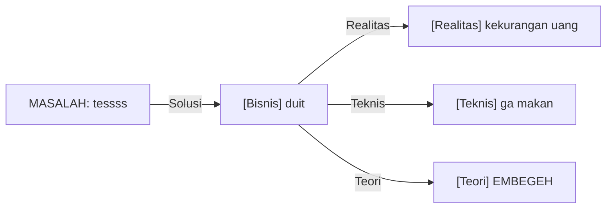

# One-Pager Ide Terpilih — Room `pkm-ki-2027`

- **Tanggal Ekspor:** Rabu, 25 November 2026 pukul 12.24
- **Diekspor oleh:** Doni

---

## TESSSS

- **Kelompok / Nama Ide:** tessss
- **Keputusan Tim:** Kandidat Aktif · **Vote:** 0▲ · **Kelengkapan:** 100%
- **Target Track / Lomba:** PKM-KI
- **Tema / Domain:** 1. Kemandirian Pangan, Energi, dan Air
- **Status Kematangan:** Ide Matang
- **Judul Final (1 kata):** TESSSS

### Jejak Bibit Awal (Ruang Ide)

- _(Doni)_ tessss

### Bedah 4 Pilar (4/4 Terisi)

> **Sintesis Akar Masalah (PoV):** gw menghadapi masalah: tessss, yang mendesak karena bukti urgentsi, sehingga membutuhkan duit.

- **01. Masalah Nyata (1):**
  - **[0▲] tessss** — tessss
- **02. Urgensi & Bukti (1):**
  - **[0▲] bukti urgentsi**
- **03. Target Pengguna (1):**
  - **[0▲] gw**
- **04. Kebutuhan Inti (1):**
  - **[0▲] duit**

### Peta Solusi & 3 Aspek Keterukuran (Mindmap)

- **[AKAR MASALAH] tessss**
  - Masalah: tessss Urgensi: bukti urgentsi Target User: gw Kebutuhan Inti: duit
  - **[SOLUSI · Bisnis] duit**
    - duit buat makan
    - **[KETERUKURAN · Realitas] kekurangan uang**
      - Dampak nyata before–after bagi pengguna/pasar.
    - **[KETERUKURAN · Teknis] ga makan**
      - Metrik performa, akurasi, kecepatan, atau kelayakan produksi.
    - **[KETERUKURAN · Teori] EMBEGEH**
      - Metode ilmiah, standar industri, regulasi, atau studi pembanding.

### Blueprint Ide Matang & Keberlanjutan

**1. Akar Masalah & Urgensi**

Masalah Nyata:
- tessss: tessss

Urgensi & Bukti:
- bukti urgentsi

**2. Target Pengguna & Nilai Manfaat**

- gw

**3. Konsep Solusi & Keunggulan Unik**

Opsi Solusi Terpilih:
- duit [Bisnis]: duit buat makan

Menjawab Kebutuhan Inti:
- duit

**4. Keterukuran — Realitas (Dampak)**

- kekurangan uang [Realitas]: Dampak nyata before–after bagi pengguna/pasar.

**5. Keterukuran — Teknis / Kelayakan**

- ga makan [Teknis]: Metrik performa, akurasi, kecepatan, atau kelayakan produksi.

**6. Keterukuran — Teori, Standar & Referensi**

- EMBEGEH [Teori]: Metode ilmiah, standar industri, regulasi, atau studi pembanding.

**7. Rencana Realisasi (MVP → Produk Jadi)**

tes

**8. Rencana Uji Pengguna (Usability Testing / UEQ)**

tess

**9. Keberlanjutan Ide & Potensi Lomba / Hilirisasi**

tes

**10. Mentor / Dosen Pendamping & Peran Tim**

tessss
